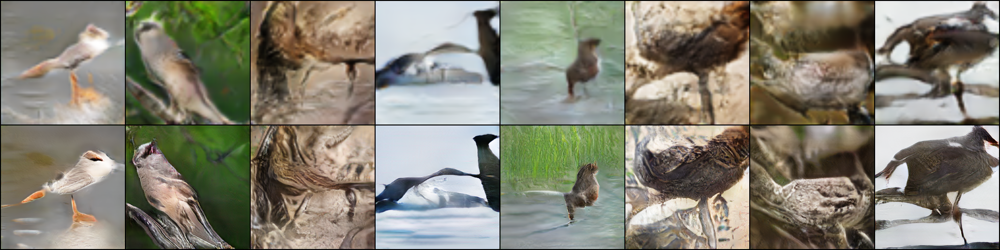

# StackGAN for CUB bird image generation

A PyTorch implementation inspired by [StackGAN](https://arxiv.org/abs/1612.03242), with practical changes for training on CUB-200-2011. Stage I generates 64×64 bird sketches; Stage II refines them into 256×256 images.

This is an experimental implementation, not an exact reproduction of the paper or a general-purpose text-to-image model. Generation requires an existing CUB caption: the repository uses precomputed 1024-dimensional char-CNN/RNN embeddings and does not include the text encoder for new prompts.

Paper: [StackGAN: Text to Photo-realistic Image Synthesis with Stacked Generative Adversarial Networks](https://arxiv.org/abs/1612.03242).

## Generation sample



## Main idea

A caption describes the bird's appearance, but it does not uniquely determine a photograph. The model combines a caption embedding with randomness to generate different poses and backgrounds that can fit the same description. Instead of learning to produce a detailed image in one step, StackGAN divides generation into two stages.

Stage I maps the text condition and a Gaussian noise vector to a 64×64 image. This stage learns the broad silhouette, colors, and composition. Conditioning augmentation predicts a mean and variance from the caption embedding and samples a condition from that distribution. Its KL penalty encourages a smooth conditioning space; the generator learns how to use the sampled noise, while the noise distribution itself stays fixed.

Stage II encodes the Stage-I image, combines its features with a separately sampled text condition, and refines the result to 256×256 through residual blocks and upsampling. Stage I stays frozen during this training. Stage II receives randomness through the generated sketch and conditioning augmentation, rather than a separate noise input. Discriminators teach each generator to produce realistic images that agree with the caption, using matched real pairs, mismatched real pairs, and generated pairs.

## Changes from the base implementation

The two-stage structure and conditioning augmentation follow the original StackGAN idea. The data pipeline and training objectives have been updated in this repository:

| Change | Purpose |
| --- | --- |
| One paired dataset keyed by filename | Keeps images and embeddings aligned when shuffling; samples one of ten captions per image instead of averaging them. |
| Padded CUB bounding-box crops | Gives the bird more pixels while retaining surrounding context before augmentation and resizing. |
| Consistent [-1, 1] normalization | Matches real images to the generators' Tanh output range. |
| Spectral normalization and no discriminator BatchNorm | Controls discriminator weights and removes the earlier discrepancy between batch statistics during training and running statistics during generator updates. |
| Hinge adversarial loss | Replaces the original sigmoid/BCE objective with margin-based discriminator supervision. |
| Three Stage-II conditional PatchGANs | Supervises image structure and detail at 64, 128, and 256 pixels, with a grid of scores at each scale. |
| Stage-II feature matching | Adds a loss matching batch-mean real and generated discriminator features at each scale. It is a distribution-level feature objective, not pixel reconstruction against a particular photograph. |
| EMA generator weights and saved samples | Smooths generator parameter changes for inference and supports visual checkpoint comparisons. |

These are experimental modifications; they do not constitute a full StackGAN-v2 implementation or establish a measured improvement over the paper. In particular, Stage II can inherit malformed anatomy from Stage I, and finer texture does not always mean a more realistic bird.

## Features

- Paired image/caption loading with random selection from ten embeddings per training image.
- Bounding-box crops with surrounding context, image augmentation, and normalization to [-1, 1].
- Conditioning augmentation with KL regularization.
- Spectral-normalized discriminators and hinge adversarial losses.
- Stage-II conditional PatchGAN supervision at 64, 128, and 256 pixels, with feature matching.
- Frozen Stage-I generator during Stage-II training and EMA weights for inference.
- Periodic samples and last, best training-loss, and best validation-loss checkpoints.
- Stage-I and full two-stage generation notebooks.

## Installation

Use Python 3.11 (the development environment). Create a virtual environment, then install:

```bash
python -m pip install -r requirements.txt
```

For notebooks:

```bash
python -m pip install jupyterlab ipython
python -m jupyter lab
```

Install compatible PyTorch and torchvision builds for your CPU/CUDA environment before the remaining dependencies if needed. CUDA is detected automatically. A GPU is recommended for training; CPU inference is supported.

## Dataset setup

Download CUB-200-2011 images and annotations and the preprocessed StackGAN bird caption embeddings. The [official StackGAN repository](https://github.com/hanzhanggit/StackGAN) provides dataset preparation references. Existing download sources: [CUB image archive](https://www.kaggle.com/datasets/veeralakrishna/200-bird-species-with-11788-images) and [caption/embedding archive](https://drive.google.com/file/d/0B3y_msrWZaXLT1BZdVdycDY5TEE/view).

Extract into the project root:

```text
CUB_200_2011/
  images/<species>/<image>.jpg
  images.txt
  bounding_boxes.txt
birds/
  text_c10/<species>/<image>.txt
  train/
    filenames.pickle
    char-CNN-RNN-embeddings.pickle
  test/
    filenames.pickle
    char-CNN-RNN-embeddings.pickle
```

The preprocessed split contains 8,855 training and 2,933 held-out images. Each image has ten 1024-dimensional caption embeddings. Image paths are matched using filenames.pickle; includes.txt is obsolete and unnecessary. Use trusted dataset archives because pickle loading executes Python serialization.

Verify the local data:

```bash
python inspect_data.py
```

Datasets, weights, training runs, generated outputs, caches, and local experimental files are excluded from Git. Download data separately and observe its original usage terms.

## Training

Run commands from the project root. Train Stage I:

```bash
python stage1_train.py --batch-size 32 --epochs 300 --lr 0.0002 --bbox-padding 0.35 --output-dir runs/stage1_bbox
```

After inspecting Stage-I samples, train Stage II with a selected Stage-I checkpoint:

```bash
python stage2_train.py --stage1-checkpoint runs/stage1_bbox/last.pt --batch-size 16 --epochs 80 --lr 0.0001 --bbox-padding 0.35 --feature-matching-weight 10 --sample-every 5 --output-dir runs/stage2_multiscale
```

Keep noise size, base channels, and crop padding consistent between stages. Stage II starts from scratch; existing Stage-II discriminator checkpoints from before the multi-scale upgrade are incompatible. The scripts save optimizer information where implemented but do not offer training resume.

Each run saves sample grids and last.pt, best_train.pt, best_val.pt, and periodic epoch checkpoints. Stage-II grids show upscaled Stage-I images above their refinements. Checkpoints include generator_ema, which inference prefers, and the frozen Stage-I weights, so a separate Stage-I file is unnecessary for two-stage generation.

The logged held-out objectives use the preprocessed test split (first caption, a limited number of batches). They are diagnostics, not FID/KID or image-quality scores. Selecting checkpoints using this split means it is no longer an untouched final benchmark. Lower combined generator/discriminator loss does not guarantee better pictures; compare sample grids, caption adherence, and diversity. Formal quality metrics and arbitrary-prompt encoding are not implemented.

## Generation

Launch Jupyter from the project root and open generate_two_stage.ipynb. Set CHECKPOINT_PATH to your selected Stage-II checkpoint, set OUTPUT_DIR and SEED, and execute the cells in order. Enter a caption when prompted. Caption matching ignores case and repeated whitespace; it otherwise requires a caption in birds/text_c10. Change SEED for another variation.

The notebook displays a side-by-side comparison and saves stage1_64.png, stage2_256.png, and comparison.png in OUTPUT_DIR. Repeated calls overwrite these names; choose a different output directory to retain separate samples. The Stage-I image is 64×64 even when enlarged for display.

generate_stage1.ipynb supports Stage-I-only inference. Both notebooks use models.py from the project root. No pretrained checkpoint is distributed with this release; load only checkpoints you trust.

## Project files

| File | Purpose |
| --- | --- |
| models.py | Stage-I/II generators and discriminators |
| utils.py | Paired CUB dataset, crop policy, and model blocks |
| stage1_train.py | Stage-I training and validation |
| stage2_train.py | Multi-scale Stage-II training and feature matching |
| inspect_data.py | Local image/caption inspection |
| generate_stage1.ipynb | Stage-I generation notebook |
| generate_two_stage.ipynb | Two-stage generation notebook |

## Checks

GitHub Actions checks the Python scripts and notebook code cells for syntax errors without requiring datasets or pretrained weights. These checks do not measure generated image quality.

## References

- [StackGAN paper](https://arxiv.org/abs/1612.03242) and [author implementation](https://github.com/hanzhanggit/StackGAN).
- [StackGAN++](https://arxiv.org/abs/1710.10916) for multi-scale generation.
- [Improved Techniques for Training GANs](https://arxiv.org/abs/1606.03498) for feature matching.
